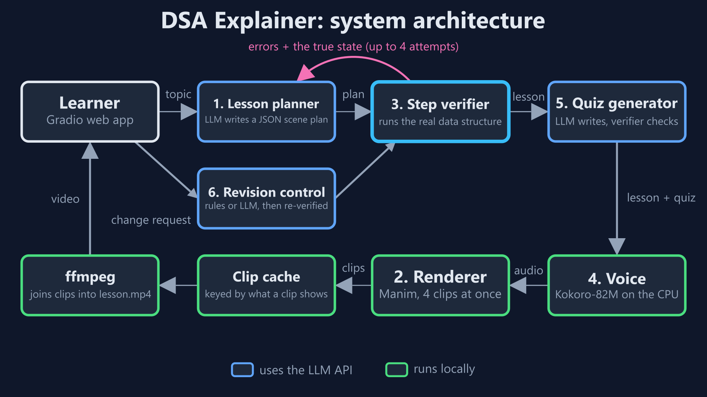

# DSA Explainer

**NLP Course Project, Fall 2026 — Project 1: Data Structure Explainer**

| Name | Registration number |
| --- | --- |
| Ahmed Javaid | 22i-2530 |
| Ammad Ashraf | 22i-2470 |

A learner types a topic such as *"how does a queue work"* or *"show BFS on this graph: A-B, A-C, B-D, start at A"*.
DSA Explainer plans a lesson, checks every step by running the real data structure, writes and speaks the
narration, animates it, and exports a video that ends with a short quiz. The learner can then say
*"slow down step 4"* or *"explain it for a beginner"*, and only that part of the video changes.

Covered: **stacks, queues, linked lists, binary search trees, and breadth-first search on a graph**.

**Demo video:** *add the Loom link*

## Documents

| Document | What it is |
| --- | --- |
| [Report](docs/report.md) ([PDF](docs/report.pdf)) | The project report: Complex Computing Problem analysis (problem statement, complexity drivers, design justification, trade-offs, societal and ethical impact), core modules, setup, technical details, testing and evaluation |
| [Architecture diagram](docs/architecture.png) | The system architecture (drawn by `scripts/make_diagram.py`) |
| [Live evaluation](docs/live-eval.md) | Results of nine real requests to the language model (`scripts/live_eval.py`) |
| [Loom video guide](docs/loom-video-guide.md) | Script and checklist for the 2 to 3 minute demo video |
| [AI prompts](docs/ai-prompts.md) | The prompts we gave our AI coding assistant |
| [Submission checklist](docs/submission-checklist.md) | What is done and what is left before submitting |

## Models, APIs and what runs locally

| Part | Model / tool | Where it runs |
| --- | --- | --- |
| Lesson planning, narration text, quiz questions, revisions | Any OpenAI-compatible LLM API; default **Gemini 3.5 Flash** (free tier), switching to **Gemini 3.5 Flash-Lite** when the daily free allowance runs out. Groq, Claude, OpenAI or a local Ollama model work by changing `.env` | API (allowed by the brief) |
| Step verifier, quiz answer checking | Plain Python data structures (`dsa_explainer/structures.py`) | Local |
| Text to speech | **Kokoro-82M** (ONNX, CPU) via `kokoro-onnx` | **Local** (required by the brief) |
| Animation | **Manim Community 0.22** (Cairo renderer, no LaTeX) | Local |
| Joining clips | ffmpeg (bundled by `imageio-ffmpeg`) | Local |
| User interface | Gradio web app | Local |

## Architecture



**The key idea: the language model never draws and never has the last word on facts.**
It writes a *structured plan*: the starting data, one operation per step (`push(7)`, `insert(6)`, `bfs_step()`),
what it believes the state is after each step (`claimed_state`), and the narration. The verifier then runs
those operations on real Python data structures. If an operation is impossible, a claimed state is wrong, or the
narration says something false ("the top is now 9"), the plan goes back to the model with the true state, up to
four attempts. If it still fails, **no video is made**, because a wrong video is worse than no video. The renderer
only ever draws the verifier's snapshots of the real structure, never the model's claims.

### The six core modules

| Module (brief) | File | How it works |
| --- | --- | --- |
| 1. Lesson planner | `planner.py`, `lesson.py` | Topic + level → JSON plan (intro, 4–8 steps, summary). Validated with Pydantic, then by the verifier; errors are fed back for repair. |
| 2. Animation renderer | `render.py` | Manim. Each structure has a drawer that turns a snapshot into named shapes; one generic `morph` animates any step by moving shapes that exist before and after, fading out removed ones and fading in new ones. Paths (BST comparisons, list walks) are highlighted first. |
| 3. Step verifier | `verifier.py`, `structures.py` | Runs every operation; compares `claimed_state` with the true state; checks narration claims (top/front/rear/head/tail/root/size/current node) and flags any number that is not in the structure or the operation; checks the video will last over 30 s. |
| 4. Narration and voice | `voice.py`, `video.py` | Kokoro-82M on the CPU. Each scene's audio is made first and the animation is timed to it, so voice and picture stay in sync. |
| 5. Quiz generator | `quiz.py` | The LLM writes multiple-choice questions that carry their own operations; each answer is checked by running them. Wrong questions are sent back; if none survive, a question is built from the lesson itself. |
| 6. Revision control | `revise.py`, `video.py` | "Slow down / speed up step N" is handled by rules; other requests go to the LLM, which may only change narration, captions, speed and summary points. The result is verified again. Clips are cached by a hash of their content, so only changed scenes are re-rendered. |

`pipeline.py` ties the modules together; `app.py` is the web interface.

## Setup (Windows, macOS or Linux; Python 3.11)

```bash
python -m venv .venv
.venv\Scripts\activate          # macOS/Linux: source .venv/bin/activate
pip install -r requirements.txt
python scripts/download_models.py   # Kokoro voice, ~350 MB, once
copy .env.example .env              # macOS/Linux: cp .env.example .env
```

Put an API key in `.env` (a free Gemini key from https://aistudio.google.com/apikey works), then check it:

```bash
python -m dsa_explainer.llm
```

## Run

```bash
python app.py
```

Open http://127.0.0.1:7860, type a topic, pick a level and press **Make video**. Under the video, type a change
such as `slow down step 4` or `explain step 2 for a beginner`.

Without an API key you can still make videos from the saved lesson plans in `examples/` (in the app, open
**"No API key? Make a video from a saved lesson plan"**, or run `python -m dsa_explainer --file examples/bst.json`).

Videos are saved in `outputs/<time>-<title>/`: `lesson_v1.mp4`, then `lesson_v2.mp4` after a change, and
the verified plan `lesson.json`.

## Tests

```bash
python -m pytest
```

The 35 tests cover every data structure, the verifier catching each kind of mistake (wrong state, false narration,
invented numbers, impossible operations, wrong quiz answers, too-short lessons), the planner's repair loop, rate
limits and the fallback model, and the revision flow (with a fake LLM, so no key is needed), plus two real clip
renders with sound. `python scripts/live_eval.py --render` runs the same checks against the real API.

## Performance (AMD Ryzen 5 3600, CPU only, 4 drawing processes)

The voice is made in the main process and each clip is handed to a drawing process as soon as its audio
exists, so speaking and drawing overlap.

| Measurement | Result |
| --- | --- |
| Stack lesson from scratch, draft 480p (129 s video, 10 clips) | 59 s (voice 52 s, drawing finishes 3 s after the last narration) |
| BFS lesson, drawing only, draft 480p / standard 720p (142 s video) | 24 s / 36 s |
| Revision "slow down step 2": 1 clip drawn, 9 reused | voice 5.5 s + drawing 5.7 s |
| Example lessons (all verified) | stack 129 s, queue 126 s, linked list 138 s, BST 154 s, BFS 142 s of video |

Planning adds one LLM call per attempt, plus one or two calls for the quiz.

## Limitations

- Free-tier API keys allow only a few requests per minute. When the provider says "rate limited", the app waits
  (10, 20, then 30 seconds) and tries again before showing a message.

- Only the five structures above. Other topics (heaps, sorting, DFS) are refused with a message rather than
  explained badly.
- At most 7 items or nodes per lesson, so the picture stays readable.
- The narration check is rule-based: it catches wrong values and false top/front/head/root/size/current-node
  statements, but not every possible wrong sentence (for example a wrong explanation of *why*).
- BFS takes neighbours in alphabetical (or numeric) order; the narration and quiz follow the same rule.
