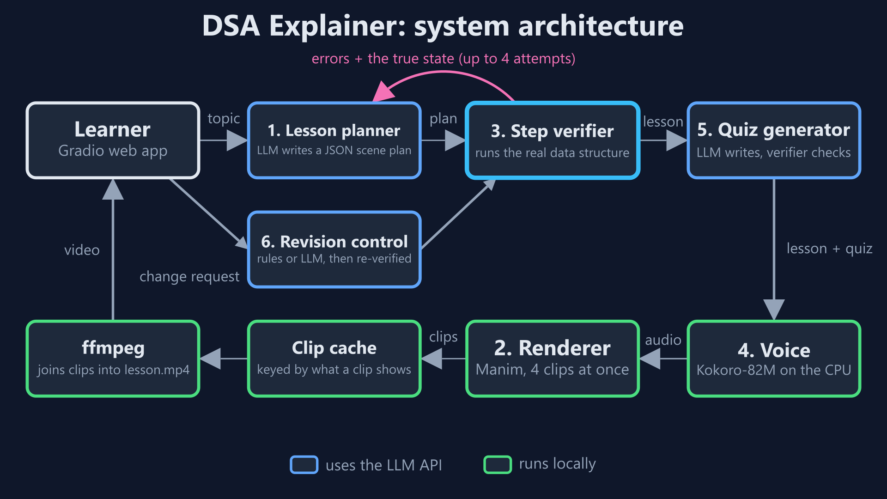

# DSA Explainer

**Natural Language Processing: Course Project, Fall 2026**
**Project 1: Data Structure Explainer**

| | |
| --- | --- |
| Group | Ahmed Javaid (22i-2530), Ammad Ashraf (22i-2470) |
| Repository | https://github.com/Ahmed-Javaid/NLP-Project-2026 (private) |
| Demo video | *add the Loom link* |
| Date | November 2026 |

---

## 1. Introduction

Data structures are hard to learn from static diagrams because they change step by step. DSA Explainer turns a
typed question such as *"how does a queue work?"* or *"show BFS on this graph: A-B, A-C, B-D, C-E, D-E, start at A"*
into a narrated, animated video lesson that ends with a short quiz. The learner can then ask for a change in plain
English, such as *"slow down step 4"* or *"explain step 2 for a beginner"*, and only that part of the video is made
again.

The design follows one sentence from the project brief: **a wrong video is worse than no video.** A language model
is good at planning a lesson and explaining it, but unreliable at tracking state: it may say the top of a stack is 9
when it is 7. So in DSA Explainer the language model never draws and never has the final word on facts. It writes a
*structured plan*; our code runs every step of that plan on real data structures; any mismatch is sent back to the
model together with the true state; and the renderer draws only states that our code computed.

The system covers **stacks, queues, singly linked lists, binary search trees and breadth-first search (BFS) on a
graph**. The brief requires linked lists, stacks, queues, trees and one graph or sorting algorithm.

## 2. Complex Computing Problem analysis

### 2.1 Problem statement

Data structures and algorithms are a core part of every computer science degree, and learners find them hard because
the structures *change*: a pointer moves, a node is replaced, a queue grows and shrinks. Understanding comes from
watching those changes one step at a time, on the learner's own question, at the learner's own level, and with
someone explaining why each step happens.

The existing options each cover only part of this:

- **Textbooks and slides** show still pictures of a few states. The learner has to imagine the transitions.
- **Algorithm visualisation websites** animate correct states, but only for fixed algorithms and the examples they
  were built with. They do not explain in words adapted to a beginner or an advanced student, they cannot answer a
  question phrased in the learner's own words, and they do not quiz the learner.
- **Recorded lectures** explain well, but the example, the pace and the level are fixed. A learner cannot ask for
  "step 4 again, slower" or "the same idea with my numbers".
- **General-purpose AI chatbots** answer any question in any style, but they track state unreliably. They can say,
  confidently, that the top of a stack is 9 when it is 7, or list a BFS order that skips a node. They also produce
  text, not a synchronised animation, and **AI video generators** draw freely, so nothing guarantees that the picture
  shows the true state.

The gap is a tool that is **flexible** like a chatbot (any phrasing, the learner's own data, three levels, changes on
request) and at the same time **guaranteed correct** like a hand-built visualiser, delivered as a narrated video with a
quiz on an ordinary laptop. A standard solution does not close this gap, because the two halves pull in opposite
directions: the component that gives flexibility (a language model) is exactly the one that cannot be trusted with
facts, and the components that are exact (simulators, fixed animations) cannot understand free-form requests.
Combining them so that each covers the other's weakness is the problem this project solves.

### 2.2 Complexity drivers

- **Conflicting requirements.** The brief asks for open-ended input ("a learner types a topic") *and* for correctness
  ("a wrong video is worse than no video"). Free text cannot be checked directly, so we had to design an
  intermediate representation, the JSON scene plan, that is expressive enough for a language model to write and
  precise enough for code to check step by step (Section 5.1).
- **No complete solution for checking language.** Operations and states can be checked exactly, but narration is free
  English. There is no known method that verifies every sentence. We check what can be checked: claims about the top,
  front, rear, head, tail, root, size and current node, and every number mentioned (Section 5.2). The rest is a known,
  documented gap (Section 9).
- **Many components that depend on each other.** The plan format must match the simulators, the drawers, the quiz's
  fact names and the revision rules. Audio length decides animation timing. The cache key of a clip must include
  everything the clip shows, or a revision would show a stale picture. A change in one component breaks others unless
  the contracts are kept, so the list of operations given to the model is generated from the simulator classes
  themselves, and 35 tests guard the contracts between components.
- **Non-deterministic and imperfect input.** The language model may return invalid JSON, a wrong state, an impossible
  operation, a refusal, or nothing at all because of an outage or a rate limit. Every one of these has to end in
  either a verified lesson or a clear message, never in a wrong video.
- **Hard resource limits.** Text to speech must run locally (brief), on a CPU, and every video must last at least
  30 seconds, which means minutes of speech and thousands of frames per lesson. Without parallel drawing and
  overlapping speech with drawing, a lesson took about two minutes to build; with them it takes about one
  (Section 6.2).
- **External limits found only in testing.** Gemini's free tier allows 20 requests a day per model. Our live
  evaluation ran into it, which forced an automatic fallback model and per-minute retry logic (Section 5.1).

### 2.3 Design justification

For each major decision we considered at least two approaches. The table lists the alternatives we rejected and why.

| Decision | Chosen | Alternative considered | Why we rejected it |
| --- | --- | --- | --- |
| How the animation is produced | The model writes a plan of operations; our renderer draws states computed by our simulators | **The model writes the animation code itself** (for example Manim code), or an AI video generator draws the video | Generated code can run without errors and still show wrong states, so correctness could not be checked. Running model-written code is also a security risk, and a failure is hard to repair automatically. The brief also says the model should not draw freely. |
| How a plan is checked | Running every step on real data structures in Python | **A second language model as a judge** of the first one's plan | A judge model can be wrong in the same way as the planner, gives different answers on different runs, doubles the number of API calls (a problem with a 20-requests-a-day free tier), and cannot produce the true state to send back. A simulation is exact, takes milliseconds and explains every rejection. |
| Where the lesson content comes from | A language model, constrained by a schema and checked by the verifier | **Fixed templates without a language model**, one hand-written lesson per structure with the values filled in | Templates cannot answer a question in the learner's own words, adapt to three levels, use the learner's own data or rewrite a scene on request, which is the natural-language part of the project. We kept the idea only as a safety net: the fallback quiz question is built from the lesson by code. |
| Which language model | A cloud API (Gemini) through an OpenAI-compatible client | **A small local model through Ollama**, as in our Assignment 3 | On this laptop's CPU, the 3-billion-parameter model from Assignment 3 took 6.6 to 16 seconds just to start answering, and models of that size are much weaker at long structured output. The brief allows APIs for planning. Ollama still works by changing `.env`. |
| How a narration claim is checked | Rule-based patterns for state facts, plus a check on every number | **A natural-language inference model** that judges whether each sentence follows from the true state | It would need an extra model on the CPU, would be slower, and would itself make mistakes we could not explain. The rules cover the facts that matter most in these lessons and every rejection is understandable. |
| How the video is built | One clip per scene, cached by content and joined with ffmpeg | **One continuous video per lesson** | Any change, even "slow down step 4", would force the whole video to be drawn again, so revision control could not change "only that part". Separate clips can also be drawn in parallel. |
| Which voice | Kokoro-82M (ONNX, local) | **Piper**, which we used in Assignment 3 | Piper is faster, but in our own testing it sounded robotic. A lesson video does not need real-time speech, so we chose the more natural voice and won the time back with parallel drawing. |

### 2.4 Trade-off analysis

| Trade-off | Our choice | Reason |
| --- | --- | --- |
| **Correctness vs. coverage** | Five structures with exact simulators, and a polite refusal for anything else | Every supported topic can be verified. Explaining heap sort without a simulator would mean showing an unchecked video, which the brief calls worse than none. In the live evaluation, both off-topic requests were refused (Section 8.3). |
| **Strict checking vs. complete checking of language** | Rule-based narration checks that catch wrong values and false state facts, but not wrong reasons or poor analogies | Deterministic, fast and explainable checks for the claims that matter most, rather than a slower second model that could also be wrong. The gap is stated in Section 9. |
| **Reliability vs. waiting time** | Up to four planning attempts and a quiz repair before giving up | Each repair adds a few seconds, but a wrong video is never shown. In the live evaluation no plan needed a repair, and the verifier still caught wrong quiz answers from the smaller model. |
| **Picture readability vs. problem size** | At most 7 items or nodes | Larger structures do not fit on screen with readable labels. Small examples are also what teaching usually uses. |
| **Voice quality vs. speed** | The full Kokoro model, with speech and drawing overlapped and 4 drawing processes | The natural voice costs about 50 seconds per lesson. Overlapping it with drawing hides most of the drawing time, so a full lesson still takes about one minute. |
| **Video quality vs. speed** | 480p "draft" by default, 720p "standard" on request | Draft is faster and good enough while trying topics; standard is there for the final video. |
| **Cost vs. model quality** | The free Gemini tier, switching to the smaller Flash-Lite model after the daily allowance | The project costs nothing to run. The smaller model's quiz questions failed verification more often, but the verifier caught every one. A paid key removes the limit. |
| **Fixed conventions vs. teaching variety** | BFS takes neighbours in alphabetical order; a BST delete uses the in-order successor | A fixed rule makes every state checkable and every quiz answer unique. Courses that teach the predecessor would need a setting. |
| **Disk space vs. revision speed** | Keep every narration and clip in a cache | A revision then redraws only the changed scene, about 10 seconds instead of a full minute, at the cost of a few megabytes per lesson. |

### 2.5 Societal and ethical impact

**Benefit and accessibility.** The tool gives any learner a patient, personalised explanation: their own question and
data, their level, the pace they ask for, and a quiz to check understanding. It runs on an ordinary laptop with no GPU,
and the voice and animation are made locally, so it does not need a paid service apart from the language model, which
has a free tier.

**Accuracy and over-trust.** Learners tend to trust a confident, polished video, so a wrong AI explanation can do real
harm to learning. This is the main ethical risk of the idea, and the main reason for the design: every state, every
checked fact and every quiz answer is verified, and a lesson that cannot be verified is not shown. The remaining risk
is narration that the rules cannot check, such as a wrong reason. The "verified" message in the app lists exactly what
was checked rather than claiming that the whole lesson is correct, and the limitation is stated in this report.

**Privacy.** The typed topic and the lesson text are sent to the language-model provider (Google, for Gemini); nothing
else leaves the computer. Learners should not type personal information into the topic box, and on free tiers a
provider may use requests to improve its services, so the provider's terms apply. The voice, the animation and the
videos stay on the user's computer. The app has no accounts and no tracking, and Gradio's analytics are switched off.
The API key is kept in `.env`, which is excluded from the repository.

**Safety and security.** The model never runs code: it can only choose operations from a fixed list (such as `push` or
`insert`), and those are carried out by our own simulators. A topic that tries to change the instructions (a prompt
injection) can at worst produce a plan that fails validation or verification. Off-topic requests are refused.

**Legal and licensing.** The components are open source: Manim (MIT), Gradio (Apache 2.0), Kokoro-82M weights (Apache
2.0) and `kokoro-onnx` (MIT). The pronunciation step uses espeak-ng, which is GPL licensed. That is fine for coursework,
but it would need review before the software was distributed commercially. Use of the Gemini API is governed by
Google's terms. Our own use of an AI coding assistant is disclosed in Section 10.

**Fairness.** The app works only in English and speaks with an American English voice, which may suit some learners
less than others. A learner with only a free API key gets the smaller fallback model once the daily allowance runs
out, so the quality of the explanation can depend on what the learner can pay for. Learners with hearing impairments
see the captions and the animation, but not a full transcript of the narration; adding subtitles would close that gap.

## 3. Requirements and how they are met

| Requirement from the brief | How DSA Explainer meets it |
| --- | --- |
| A learner types a topic; the system plans a lesson, writes the narration, draws the animation, adds a voice and exports a video with a quiz at the end | Web app → lesson planner → step verifier → quiz generator → Kokoro voice → Manim clips → one mp4 |
| Cover at least linked lists, stacks, queues, trees and one graph or sorting algorithm | Stack, queue, linked list, binary search tree and BFS, each with its own simulator and drawer |
| Every video is at least 30 seconds long | The verifier rejects plans with fewer than 90 words of narration (about 36 s of speech). Real lessons last 2 to 2.5 minutes |
| The language model produces a structured scene plan that the renderer draws | A JSON scene plan, validated with Pydantic. The renderer reads only the verifier's snapshots |
| The system checks that the explanation is correct | Every operation is run on a real data structure; claimed states, narration facts, numbers and quiz answers are checked |
| Text to speech runs locally | Kokoro-82M through ONNX on the CPU |
| A user interface usable without touching the code | Gradio web app |
| Runs on a normal laptop by following the README | CPU only; checked from a fresh clone of the repository (Section 8.2) |

The six core modules are described in Section 5.

## 4. System architecture



1. The learner types a topic and picks a level (beginner, intermediate or advanced) in the web app.
2. The **lesson planner** sends the topic, the level and a reference of the supported structures to the language
   model, which returns a JSON scene plan.
3. The plan is checked against a Pydantic schema, and then the **step verifier** runs it on a real data structure.
   Any problem is sent back to the planner together with the true state, for up to four attempts in total. If no
   attempt passes, no video is made.
4. The **quiz generator** asks the model for multiple-choice questions. Each question carries its own operations,
   which the verifier runs to confirm the answer.
5. **Kokoro** speaks each scene's narration on the local CPU. As soon as a scene's audio exists, the scene is handed
   to one of four drawing processes, and the **renderer** (Manim) draws it from the verifier's snapshots, timed to
   the audio.
6. Each clip is stored in a cache under a hash of everything it shows and says, and **ffmpeg** joins the clips into
   `lesson_v1.mp4`.
7. A change request goes through **revision control**, is verified again, and only the clips whose content changed
   are drawn again.

## 5. Core modules

### 5.1 Lesson planner (`planner.py`, `lesson.py`)

The planner turns a topic and a learner level into a `Lesson`: a title, the structure, its initial data and a list
of scenes. A plan has one intro scene, 4 to 8 step scenes and one summary scene. Each step holds exactly one
operation, the state the model expects after it (`claimed_state`), a short on-screen caption and the narration.
One step from `examples/stack.json`:

```json
{
  "kind": "step",
  "caption": "push(7)",
  "op": {"name": "push", "args": {"value": 7}},
  "claimed_state": [4, 9, 2, 7],
  "narration": "Next we push 7. Again it goes on the top, above 2. The stack keeps items in the order they arrived, with the newest one on top. The top is now 7."
}
```

**Prompt design.** The list of supported structures, their operations and their state formats is generated from
the simulator classes themselves (`structures.catalog()`), so the prompt and the verifier can never disagree. The
rules ask for plain spoken sentences, digits for numbers, 25 to 60 words per scene, small values (1 to 99, or single
letters for graph nodes), at most 7 items, a style that matches the level (analogies for beginners, time complexity
for intermediate, edge cases and trade-offs for advanced), the learner's own data when they give it, and a JSON
`{"error": "unsupported"}` reply for topics outside the five structures.

**Validation and repair.** The reply is parsed (code fences and surrounding text are tolerated) and validated with
Pydantic. The step verifier then runs it. If anything is wrong, the errors are sent back as a new message, for
example *"step 2 (push(7)): claimed_state [4, 9, 7] is wrong; the real state after this step is [4, 9, 2, 7]"*, and
the model returns a corrected plan. After four failed attempts the planner stops and no video is made.

**Any provider.** `llm.py` talks to any OpenAI-compatible chat API, so Gemini (the default, `gemini-3.5-flash` on
the free tier), Groq, Claude, OpenAI or a local Ollama model can be used by changing three lines in `.env`. JSON mode
is used when the provider supports it. Free tiers are tight: Gemini's free tier allows a few requests per minute and
only 20 per day for each model. When the provider answers "rate limited", the client waits 10, 20 and then 30 seconds
and tries again. When the limit is the *daily* one, waiting does not help, so the client switches to a fallback model
with its own allowance (`gemini-3.5-flash-lite`), and the report under the video names the model that was used.

### 5.2 Step verifier (`verifier.py`, `structures.py`)

`structures.py` holds one plain Python class per structure: `Stack`, `Queue`, `LinkedList`, `BST` and `Graph` (BFS).
Each class lists its operations, runs them (`run`), and reports its plain state (`state`), named facts such as top,
front, rear, head, tail, root, size, in-order traversal or BFS order (`facts`), and a snapshot with a stable id per
element for the animation (`snapshot`). Impossible operations raise an error, for example *"cannot pop: the stack is
empty"*. Conventions are fixed and given to the model: a BST has no duplicates and a node with two children is
replaced by its in-order successor; BFS takes neighbours in alphabetical (or numeric) order.

The verifier checks a plan at four levels:

1. **Shape:** one intro first, one summary last, 3 to 10 steps, and at least 90 words of narration so the video lasts
   more than 30 seconds.
2. **Operations:** every step's operation must be possible on the current state.
3. **States:** every `claimed_state` must equal the true state after the step. Values are compared as text, so `5`
   and `"5"` match, and trees are compared as nested structures.
4. **Narration:** two rule-based checks.

    - *Fact claims.* Regular expressions find statements such as "the top of the stack is now 7", "5 is at the
      front", "the size is three" or "the current node is B". Each claim is compared with the facts just before and
      just after the step, since narration may describe either. Words that are not values ("the top is where new
      plates go") are ignored.
    - *Stray numbers.* Every number in the narration must be a value in the structure, an argument of the operation,
      or a small count; Big-O expressions and "step 3" are ignored. This catches invented values, such as "we push
      12" in a step that pushes 7.

Quiz questions are checked the same way (Section 5.5). The verifier also produces one *frame* per scene (the
snapshots before and after it, plus the elements to highlight), and these frames are the renderer's only input.

The checks are rule-based on purpose: they are deterministic, run in milliseconds, need no second model that would
itself have to be trusted, and every rejection can be explained. The limitation is that they cannot judge every
sentence (Section 9).

### 5.3 Animation renderer (`render.py`)

The renderer uses Manim Community 0.22 with its Cairo backend (no LaTeX needed) and makes one short clip per scene.

**Drawers.** Each structure has a drawer that turns a snapshot into a dictionary of named shapes. Keys are element
ids for stack, queue, list and tree items, `("next", id)` for list arrows, `("edge", a, b)` for tree and graph edges,
and `("token", node)` for the BFS queue and visited rows.

**One animation for every operation.** To animate a step, a single `morph` function moves every shape whose key
exists in both pictures, fades out the keys that disappeared and fades in the new ones. The same code therefore
animates a push or pop, an enqueue or dequeue, a list insert or delete, a BST insert or a delete with a successor
swap, and a BFS step, in which the node's token slides from the queue row to the visited row.

**Choreography of a step:**

1. walk the path the operation takes (the nodes compared in a BST, the nodes visited in a list walk, or the node
   leaving the BFS queue);
2. morph into the true state after the operation, with the path in blue and new elements in green;
3. pulse what is new;
4. hold until the narration ends;
5. return to plain colours, so the next clip starts from exactly the same picture.

**Layouts.** A stack is drawn vertically inside walls with a "top" pointer. A queue is a row with "front" and "rear"
pointers. A linked list is a row of nodes joined by arrows that ends in "null", with a "head" pointer. A BST places
each node by its in-order position (x) and depth (y). A graph is laid out in rows by BFS distance from the start
node, with queue and visited rows and a colour legend (current, in queue, visited). The intro, summary and quiz
scenes have their own title card, bullet list and answer layouts. Videos are made at 854×480 and 15 fps ("draft") or
1280×720 and 30 fps ("standard").

### 5.4 Narration and voice (`voice.py`, `video.py`)

Narration is spoken by **Kokoro-82M** (82 million parameters, Apache 2.0 licence) through `kokoro-onnx` on the
CPU, using the `af_heart` voice at 24 kHz. No speech API is used. Before speaking, the text is cleaned, for example
"O(n)" becomes "O of n".

**Synchronisation.** Each scene's audio is made first, and its clip is timed to that audio: the animation phases fit
inside the narration, and the scene then holds until the narration ends. A short silent pad makes each clip's audio
track cover the whole clip, so the joined video stays in sync. On a 10-clip lesson the joined video track lasts
142.58 s and the audio track 142.63 s.

**Caching and speed.** Audio files are named by a hash of the voice, the speed and the text, so a narration that did
not change is never spoken again. Revisions can change a scene's speed, which slows Kokoro's speech and stretches
the animation.

### 5.5 Quiz generator (`quiz.py`)

The model receives the lesson's initial data, its operations, its final state and the reference for the structure,
and writes two multiple-choice questions. Every question carries its own start data, operations, the name of the
fact being asked (for example `front`, `inorder` or `bfs_order`), three or four options, the answer and a one-line
explanation. The verifier runs the operations on a fresh structure and checks that the given answer equals the
computed fact, that exactly one option is correct, that the options differ, and that the explanation mentions no
numbers from outside the question. Wrong questions are sent back once with the reason; if none survive, a question
is built from the lesson itself. In the video, each question and its options are read aloud, a three-second timer
bar runs, and the correct option is highlighted while the answer and explanation are spoken.

### 5.6 Revision control (`revise.py`, `video.py`)

**Speed requests** ("slow down step 4", "speed up the summary") are handled by rules, with no model call: the named
scenes play at 0.75× or 1.25× speed.

**Other requests** ("explain step 2 for a beginner", "make the summary shorter") go to the model, which sees each
scene's caption, operation, true state, speed and narration. It may change only the narration, caption, speed,
summary points and level. Operations and values are fixed, so every picture stays verified. The revised lesson is
verified again, with up to three attempts; if it still fails, the old video is kept.

**Only that part changes.** Each clip is cached under a SHA-1 hash of everything it shows and says: the title,
caption, narration, speed, before and after snapshots, highlighted elements, quality and renderer version. After a
revision, unchanged scenes are found in the cache and only the changed ones are drawn. The new video is saved as
`lesson_v2.mp4`, then `lesson_v3.mp4`, and so on. For example, "slow down step 2" drew 1 clip and reused 9, in 5.5 s
of voice and 5.7 s of drawing.

## 6. Technical details

### 6.1 Models, APIs and where they run

| Part | Model or tool | Where it runs |
| --- | --- | --- |
| Lesson planning, narration text, quiz questions, rewrite requests | Gemini 3.5 Flash, with Gemini 3.5 Flash-Lite as the fallback, through Google's OpenAI-compatible API (any OpenAI-compatible provider works) | API |
| Step verifier and quiz answer checking | Plain Python | Local |
| Text to speech | Kokoro-82M (ONNX) | Local, CPU |
| Animation | Manim Community 0.22 (Cairo) | Local, CPU |
| Joining clips | ffmpeg (bundled by `imageio-ffmpeg`), stream copy | Local |
| Web interface | Gradio 6 | Local |

### 6.2 Speed and parallelism

The voice runs in the main process. Each clip is given to a pool of four drawing processes as soon as its audio
exists, so speaking and drawing overlap, and clips are drawn in parallel. The clips are joined without re-encoding.

| Measurement (AMD Ryzen 5 3600, CPU only) | Result |
| --- | --- |
| Stack lesson made from scratch, draft quality (129 s of video, 10 clips) | 59 s (voice 52 s; drawing ends 3 s after the last narration) |
| BFS lesson, drawing only, draft / standard quality (142 s of video) | 24 s / 36 s |
| A full lesson from a typed topic with Gemini, including planning and quiz (130 s of video) | 95 s |
| Revision "slow down step 2": 1 clip drawn, 9 reused | 5.5 s voice + 5.7 s drawing |

### 6.3 User interface

The Gradio web app has a topic box, a level and a quality selector, clickable example topics, and a section that
makes videos from the saved lesson plans in `examples/`, which works without an API key. Beside the video player
are a box for change requests and a list of the parts that can be changed. Below it are a verification report
(checks passed, any plans the verifier sent back, clips drawn or reused, and timings), the quiz with answers hidden
behind a click, and the verified lesson plan as JSON. Progress messages ("Planning the lesson (attempt 1)", "Speaking
step 3", "Drew step 5") are shown while a video is made.

### 6.4 Code organisation

| File | Lines | Purpose |
| --- | --- | --- |
| `dsa_explainer/structures.py` | 519 | The five data structures (simulators) |
| `dsa_explainer/render.py` | 363 | Manim drawers, the generic morph, scene layouts |
| `dsa_explainer/verifier.py` | 238 | Plan, narration and quiz checks |
| `dsa_explainer/revise.py` | 119 | Revision control |
| `dsa_explainer/video.py` | 106 | Voice and drawing in parallel, cache, joining |
| `dsa_explainer/planner.py` | 99 | Lesson planner prompt and repair loop |
| `dsa_explainer/quiz.py` | 85 | Quiz generator |
| `dsa_explainer/voice.py` | 76 | Kokoro text to speech |
| `dsa_explainer/llm.py` | 98 | Client for OpenAI-compatible APIs, rate limits, fallback model |
| `dsa_explainer/lesson.py` | 62 | Scene plan schema (Pydantic) |
| `dsa_explainer/pipeline.py` | 58 | Ties the modules together |
| `app.py` | 149 | Web interface |
| `tests/` | 359 | 35 automated tests |
| `scripts/` | | Live evaluation, diagram, report PDF, voice download |

## 7. Setup and use

```bash
python -m venv .venv
.venv\Scripts\activate                 # macOS/Linux: source .venv/bin/activate
pip install -r requirements.txt
python scripts/download_models.py      # Kokoro voice, about 350 MB, once
copy .env.example .env                 # then paste an API key into .env
python -m dsa_explainer.llm            # checks the key and the model
python app.py                          # opens http://127.0.0.1:7860
```

The README gives the full instructions, including how to use other providers and how to make videos from saved plans
without an API key.

## 8. Testing and evaluation

### 8.1 Automated tests

`python -m pytest` runs 35 tests in about 15 seconds:

- **Data structures (8 tests):** every operation of all five structures, impossible operations, the BST successor
  rule and BFS order.
- **Verifier (13 tests):** all five example lessons pass, and each kind of mistake is caught: a wrong state, a false
  narration fact, an invented number, an impossible operation, a wrong quiz answer and a lesson that is too short.
  The fact-claim patterns and the number filter are tested directly.
- **Planner and API client (6 tests, fake model):** a wrong plan is sent back with the true state and the corrected
  plan is accepted; an unsupported topic is refused; no video is made after four bad replies; JSON is parsed from
  fenced replies; a per-minute rate limit is waited out and retried; a daily limit switches to the fallback model.
- **Quiz and revisions (6 tests, fake model):** answers are computed by running the operations; a wrong question is
  repaired; the fallback question is correct; "slow down step 4" changes only step 4; an unknown step is refused; a
  rewrite that states a false fact is sent back and fixed.
- **Rendering (2 tests):** a real clip with sound is made for a stack step and a BFS step.

### 8.2 Fresh install

The repository was cloned into an empty folder and set up exactly as the README describes: a new virtual environment,
`pip install -r requirements.txt`, the voice download script, the test suite, and a video made from a saved plan.
Every step worked: the install finished without errors, the download script found both voice files at their source
with the expected sizes, all the tests passed, and the binary search tree lesson was made (155 seconds of video).

### 8.3 Live evaluation with Gemini

`scripts/live_eval.py` sends nine requests to the real model: seven supported topics across all five structures and
all three levels (two of them with data typed by the learner), and two topics that must be refused. It also makes
every accepted lesson into a video, and tries two rewrite revisions. The full results are in `docs/live-eval.md`.

| # | Request | Level | Model | Result | Plan attempts | Quiz | Video |
| --- | --- | --- | --- | --- | --- | --- | --- |
| 1 | How does a stack work? | beginner | 3.5 Flash | lesson | 1 | 2 verified | 152 s |
| 2 | Show how a queue handles print jobs | intermediate | 3.5 Flash | lesson | 1 | 2 verified | 159 s |
| 3 | How do you insert into the middle of a linked list? | beginner | 3.5 Flash | lesson | 1 | 2 verified | 148 s |
| 4 | Insert 8, 3, 10, 1, 6, 14 into a BST, then delete 3 | intermediate | 3.5 Flash | lesson | 1 | 2 verified | 193 s |
| 5 | Show BFS on this graph: A-B, A-C, B-D, C-E, D-E, start at A | beginner | 3.5 Flash | lesson | 1 | 2 verified | 130 s |
| 6 | Explain deleting a node with two children from a BST | advanced | 3.5 Flash-Lite | lesson | 1 | fallback question after 2 rejected attempts | 85 s |
| 7 | How does breadth-first search work? | intermediate | 3.5 Flash-Lite | lesson | 1 | 2 verified on the 2nd attempt | 124 s |
| 8 | Explain heap sort | beginner | 3.5 Flash-Lite | refused | | | |
| 9 | What is the capital of France? | beginner | 3.5 Flash-Lite | refused | | | |

What the run shows:

- **9 of 9 requests got the expected result:** seven lessons and two refusals. The refusals explain that only
  stacks, queues, linked lists, binary search trees and graphs are covered.
- **All seven lesson plans passed the verifier on the first attempt**, including both learner-typed data sets, the
  binary search tree delete with a successor swap and the advanced level. Every accepted lesson passed every check.
- **The verifier caught wrong quiz answers.** With the smaller fallback model, the questions for lesson 7 were
  rejected once and corrected, and the questions for lesson 6 were wrong twice, so that lesson received the question
  built from the lesson itself. No wrong answer reached a video.
- **Rewrite revisions changed only the part asked for:** "explain step 2 for a beginner" changed step 2, and "make
  the summary shorter" changed the summary. Both passed verification on the first attempt, in 4 s and 2 s.
- **Free-tier limits are real.** After lesson 5 the run reached Gemini's limit of 20 requests a day for
  `gemini-3.5-flash`. This led us to add the automatic fallback model (Section 5.1), which carried out lessons 6 to 9
  and the revisions. Planning times for lessons 1 to 5 were not recorded, because that part of the run was
  interrupted by the limit and resumed later; a separate full lesson with `gemini-3.5-flash` took 95 s from the typed
  topic to the finished video (Section 6.2).

### 8.4 Example lessons

Five verified lesson plans are included in `examples/`, one per structure. They are used by the tests, they work
without an API key, and they rendered into videos of 126 to 154 seconds:

| Lesson | Level | Steps | Checks passed | Video |
| --- | --- | --- | --- | --- |
| How a Stack Works | beginner | 6 | 27 | 129 s |
| Queues: First In, First Out | intermediate | 6 | 28 | 126 s |
| Linked Lists, Node by Node | beginner | 6 | 27 | 138 s |
| Binary Search Trees | intermediate | 6 | 23 | 154 s |
| Breadth-First Search | beginner | 6 | 23 | 142 s |

## 9. Limitations and future work

- **Scope.** Only the five structures are supported. Other topics (heaps, sorting, depth-first search) are refused
  with a message rather than explained badly. Adding one means writing a simulator class and a drawer; the planner,
  verifier, quiz and revision code need no change.
- **Size.** At most 7 items or nodes per lesson, so the picture stays readable.
- **Narration checks are rule-based.** They catch wrong values and false statements about the top, front, rear,
  head, tail, root, size and current node, but not every wrong sentence, such as a wrong reason or a misleading
  analogy. A second model acting as a judge could be added, at the cost of time and of trusting that model.
- **Fixed conventions.** BFS takes neighbours in alphabetical order and BST deletion uses the in-order successor. A
  course that teaches the predecessor would need a setting.
- **Speed.** A new lesson takes about a minute and a half on a six-core CPU, most of it speech synthesis. The quantised
  Kokoro model or a GPU would shorten this.
- **Free API limits.** Gemini's free tier allows about 20 requests a day per model, and a lesson needs at least two.
  The fallback model keeps the app working, but it is smaller: in our evaluation its quiz questions were rejected
  more often (the verifier caught every one). A paid key or another provider removes the limit.

## 10. Use of generative AI tools

As the brief allows, we used an AI coding assistant (Claude Code) while building this project. It drafted code,
tests and documentation from our instructions, and we reviewed, ran and tested the results. The prompts that the
application itself sends to the language model are in the code (`planner.py`, `quiz.py` and `revise.py`), and the
prompts we gave the assistant are listed in `docs/ai-prompts.md`.

## 11. Conclusion

DSA Explainer produces narrated, animated data-structure lessons with quizzes and targeted revisions, and it keeps
them correct by never trusting the language model with facts: every step is run on real data structures before
anything is drawn, wrong plans are repaired with the true state, and the video is drawn only from verified states.
The speech and the animation run locally on an ordinary laptop CPU, and only lesson planning and writing use an API.
