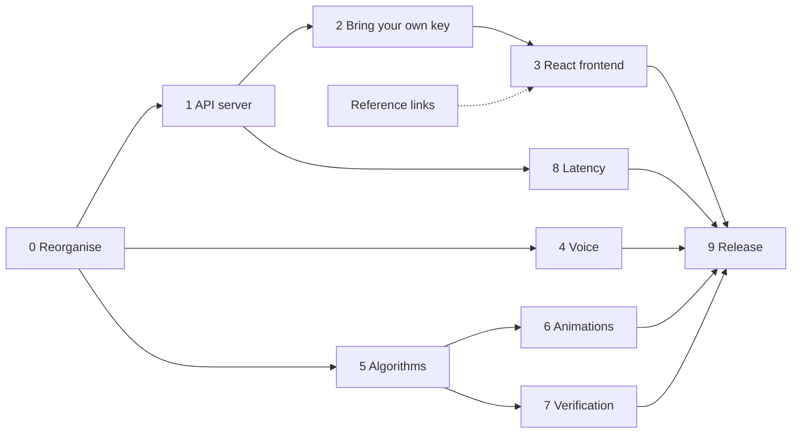

# Milestones

How the ideas in [vision.md](vision.md) become work. Each milestone says why it exists, what it changes in the code,
and how we know it is done. The findings come from reading the current code (paths are inside
`backend/dsa_explainer/`).

## Rules for every milestone

- **The verifier invariant is never relaxed.** The language model never has the last word on facts; the renderer
  draws only the verifier's snapshots of the real simulation. New features add checks, never remove them.
- **Tests stay green and the app keeps running** after every milestone. Each milestone adds tests for what it adds.
- All work lands on `feat/open-source-platform`. `main` stays as the course submission until that is final.

## Overview

| # | Milestone | Size | Depends on | Status |
| --- | --- | --- | --- | --- |
| 0 | Reorganise the repository and write the roadmap | S | | **Done** |
| 1 | Local API server (FastAPI) | M | 0 | Ready |
| 2 | Bring-your-own-key, provider-independent LLM layer | M | 1 | Ready |
| 3 | React frontend | L | 1, 2, **reference links** | Blocked on the two reference links |
| 4 | Voice: research and pluggable voice engines | M | 0 | Ready (research can start any time) |
| 5 | Algorithm plugin architecture, new algorithms, saved-plan library | L | 0 | Ready |
| 6 | Richer, still-verified animations | L | 5 (and 3 for the design tokens) | After 5 |
| 7 | Stronger verification and an evaluation harness | M | 5 | After 5 |
| 8 | Latency and responsiveness | M | 1 | After 1 |
| 9 | Open-source release | M | all above | Last |

Sizes are relative (S, M, L), not time estimates.

**Suggested order:** 1 and 2 first, because the React app needs them and they are not blocked. Start 5 next (or in
parallel), because it is the backbone for every new algorithm and for 6 and 7. The research part of 4 can run any time.
Start 3 as soon as the two reference links are shared.

---

## Milestone 0: Reorganise the repository and write the roadmap (done)

- Monorepo layout: `backend/` (Python pipeline) now, `frontend/` (React) in Milestone 3.
- The package is grouped by pipeline stage: `core/` (schema, simulators, verifier: no AI, no I/O), `authoring/`
  (everything the language model writes), `media/` (voice, animation, video). Saved plans moved to
  `dsa_explainer/plans/`.
- Course documents moved to `docs/course/`; this roadmap is in `docs/roadmap/`.
- `.gitignore` patterns are anchored to the repository root, so runtime folders (`models/`, `cache/`, `outputs/`,
  Manim's `media/`) never hide source folders with the same name.
- No behaviour change: all 35 tests pass.

## Milestone 1: Local API server (FastAPI)

**Why.** A React app needs an HTTP API. Today the pipeline is called directly from Gradio callbacks in `app.py`, and
progress reaches the page only through Gradio's own progress bar.

**Scope**
- `dsa_explainer/api/`: a FastAPI app on `127.0.0.1` with:
  - `POST /lessons` (topic, level, quality) returns a job id; `POST /plans/{id}/render` renders a saved plan;
    `POST /lessons/{id}/revisions` applies a change.
  - `GET /jobs/{id}/events`: Server-Sent Events with the stage, progress, messages, and each clip as it finishes.
  - `GET /lessons`, `GET /lessons/{id}`: the learner's lesson history (from `outputs/`), the verified plan, the
    verification report and the quiz.
  - Video files served with HTTP range requests, so the player can seek.
  - `GET /plans`, `GET /algorithms`, `GET /health`.
- A job runner with one worker (drawing is CPU-bound and the voice engine is not thread-safe), a queue, and
  cancellation.
- The OpenAPI schema is exported so the frontend can generate its TypeScript types from it.
- Gradio keeps working on top of the same pipeline until Milestone 3 replaces it.

**Done when** every Gradio action works over the API, each endpoint has a test (with a fake LLM), and Gradio still runs.

## Milestone 2: Bring-your-own-key, provider-independent LLM layer

**Why.** The learner should use their own key and provider. Today `authoring/llm.py` keeps the client, the
fallback flag and the JSON-mode flag in module-level globals (`_client`, `_on_fallback`, `_json_mode`) built from
`.env` at start-up, so the whole process has exactly one key and one provider.

**Scope**
- `authoring/providers/`: one `LLMProvider` interface (`chat_json`, `list_models`, `check`) with:
  - an OpenAI-compatible adapter (OpenAI, Gemini, Groq, OpenRouter, Ollama, LM Studio, or any custom base URL),
  - a native Anthropic adapter (native SDK features arrive there first),
  - a registry of provider presets: base URL, default and fallback models, where to get a key, free-tier notes.
- Settings travel with each request (`LLMSettings`) through the planner, quiz writer and reviser. No globals; rate-limit
  waits and the fallback model are tracked per client.
- **Structured output:** generate a JSON Schema from the Pydantic `Lesson` and `Question` models and use each provider's
  schema-constrained output where it exists, with JSON mode as the fallback. Fewer malformed plans means fewer repair
  rounds. The verifier repair loop stays.
- **Key safety:** keys are entered in the app and stored only on the user's machine (the OS keychain through
  `keyring`, falling back to a local settings file with a clear warning). Keys are never logged, are redacted from
  error messages, and are sent only to the provider the user chose. `.env` still works as the default.
- Prompts move out of the code into versioned prompt files; the prompt version is saved in each `lesson.json`.
- API: `GET /providers`, `POST /providers/test`, `GET /providers/{id}/models`.

**Done when** a lesson can be made with keys entered in the app for at least Gemini, an OpenAI-compatible provider,
Anthropic and a local Ollama model; tests use fake providers; a test checks that no key appears in logs or errors.

## Milestone 3: React frontend

**Blocked on** the layout reference app and the design-system reference site (see [vision.md](vision.md)).

**Scope**
- `frontend/`: Vite, React and TypeScript, React Router, TanStack Query, and API types generated from the backend's
  OpenAPI schema so the two cannot drift apart.
- **Design system:** extract the reference site's tokens (colours, type scale, spacing, radii, shadows) into CSS
  variables with light and dark themes, then build the component primitives on them.
- **Pages and sections:** designed from the analysis of the reference app. The features they must cover:
  - create a lesson (topic, level, quality) with example prompts,
  - live progress: a stage timeline fed by the job events, including how many plans the verifier sent back and why,
  - the player: scene chapters, the quiz, the "change part of the video" box, and the verification report,
  - the library of saved plans, by algorithm and difficulty,
  - the learner's lesson history,
  - settings: provider, key, model, voice, video quality,
  - "how it works": the verification story, which is what sets this project apart.
- Captions: a WebVTT track built from the narration (word-timed once Milestone 4 lands).
- One command starts everything: the backend serves the built frontend on `127.0.0.1` and opens the browser. In
  development, Vite proxies to the API.
- Keyboard navigation and screen-reader labels throughout.
- **Gradio is removed** once React reaches parity.

**Done when** every Gradio feature exists in React, Gradio is gone, and a Playwright smoke test makes a video from a
saved plan end to end.

## Milestone 4: Voice research and pluggable voice engines

**Why.** Kokoro-82M works and its audio drives the animation timing, but voice synthesis is the slowest stage (52 of
the 59 seconds for the stack lesson in the README), and the open-weight speech field moves fast.

**Scope**
- **Research first**, written up in `docs/research/voice-models.md`. Survey current open-weight text-to-speech
  models on Hugging Face and elsewhere, and measure each candidate on our own narration:
  - licence of both the code and the weights (open-source distribution needs permissive terms on both),
  - CPU speed (real-time factor) on our reference laptop, and optional GPU speed,
  - quality in a blind A/B test against Kokoro, with technical terms ("O of n log n", "enqueue", node names),
  - **word-level timestamps**, which unlock finer synchronisation,
  - download size, ONNX or other portable runtimes, Windows, macOS and Linux support, voices and languages.
  Kokoro is the baseline every candidate has to beat.
- `media/voices/`: a voice-engine interface (`synthesize(text, voice, speed)` returning audio and optional word
  timings). Kokoro stays the default; the best candidates become selectable engines.
- Word timings feed captions (Milestone 3) and word-synced highlights in the animation (Milestone 6). The current
  scene-level synchronisation stays as the base.
- A pronunciation lexicon for data-structure terms, with tests for the spoken-text normaliser.
- Licence check: `kokoro-onnx` phonemises through espeak-ng (GPL-3.0); decide whether that is acceptable for the
  release licence or needs a different phonemiser.

**Done when** the research document has measurements, at least one new engine can be selected, captions are produced,
and Kokoro still works unchanged.

## Milestone 5: Algorithm plugin architecture, new algorithms and the saved-plan library

**Why.** Adding one algorithm today touches at least six places: the simulator in `core/structures.py` (all five
structures in one 519-line file), `STRUCTURES` and `DISPLAY_NAMES`, the drawers and the `ENTER`/`EXIT` tables in
`media/render.py`, the fixed fact vocabulary `_FACT_WORDS` in `core/verifier.py`, and the structure list hard-coded
in the planner prompt (`"<stack | queue | linked_list | bst | graph>"`).

**Scope**
- `algorithms/<name>/`, one package per algorithm, holding: the simulator (operations, state, facts, snapshot), the
  drawer, metadata (display name, category, difficulty, the description given to the planner, the fact words and
  synonyms the narration checker understands), and its saved plans. A registry discovers them; the planner prompt,
  verifier, renderer and app catalogue all read from it.
- **Migrate the five existing structures first, with no behaviour change** (same tests, same pictures).
- Add algorithms in waves (to be adjusted to the course syllabus and to what learners ask for):
  1. **Arrays and sorting:** array operations, binary search, bubble, insertion, selection, merge and quick sort,
     deque, circular queue.
  2. **Trees and heaps:** binary heap and priority queue (array and tree views together), heap sort, AVL rotations,
     trie, step-by-step tree traversals.
  3. **Graphs:** depth-first search, Dijkstra, topological sort, union-find, Kruskal, Prim.
  4. **Hashing and dynamic programming:** hash tables (chaining and open addressing), DP tables (Fibonacci, LCS,
     knapsack).
- **Property-based tests** (Hypothesis) check every simulator against a reference implementation on random operation
  sequences: heaps against `heapq`, sorts against `sorted`, BST invariants after random inserts and deletes, shortest
  paths against a reference implementation.
- **Saved-plan library:** `scripts/generate_plans.py` generates plans per algorithm, level and scenario with the latest
  Claude model. Every plan must pass the verifier and is stored with its provenance (model, prompt version, date).
  A short human review checklist covers what the verifier cannot judge (clarity, analogies).

**Done when** adding an algorithm means one new folder plus its tests, the original five are migrated, waves 1 and 2
are in, and every algorithm has at least three verified saved plans.

## Milestone 6: Richer, still-verified animations

**Why.** Today one generic `morph` animates every step: shapes move, fade out or fade in. It shows *what* changed, but
less of *why* (comparisons, swaps, pointer moves).

**Scope**
- Simulators report richer, verified detail in their snapshots: comparisons, swaps, pointer variables (`i`, `j`, `lo`,
  `mid`, `hi`), the recursion stack. The renderer can then show reasoning, still only from verified data.
- A **pseudocode panel** whose highlighted line comes from the simulator, not the language model.
- Operation-specific animations alongside the generic morph: swap arcs, re-linked pointers, tree rotations, sift-up and
  sift-down paths, bar charts for sorting.
- Counters for comparisons and swaps, taken from the simulator.
- Video styling from the Milestone 3 design tokens, so the video and the app match; a 1080p option; title and end cards.
- Word-synced highlights, using the Milestone 4 timings.
- **Visual regression tests:** render key frames of each saved plan and compare them with approved images.

**Done when** each algorithm has operation-specific animations and a pseudocode panel, and visual regression tests
guard them.

## Milestone 7: Stronger verification and an evaluation harness

**Why.** The narration checker is a set of regular expressions over a fixed list of fact words (`_CLAIM_A`,
`_CLAIM_B` in `core/verifier.py`). It catches "the top is now 9" but misses paraphrases ("the stack now holds three
items"), and it cannot judge explanations of *why*.

**Scope**
- **Declared claims:** the planner returns, for each scene, the facts its narration states (`claims: [{fact, value}]`).
  The verifier checks every claim exactly and checks that the narration expresses it; the regular expressions stay as
  a backstop for claims that were not declared.
- **Advisory second opinion:** an optional review by a second model flags doubtful explanations. It is shown in the
  report but never overrides the verifier.
- **Better quizzes:** more question types (predict the next state, which operation produced this state, complexity),
  and distractors made from simulated common mistakes (FIFO instead of LIFO, off-by-one), each verified to be wrong.
- **Mutation testing of the verifier:** corrupt correct plans automatically (wrong state, wrong value in narration,
  impossible operation) and measure how many corruptions it catches.
- **Evaluation harness** (extends `scripts/live_eval.py`): a fixed topic set per algorithm, measuring first-attempt
  pass rate, attempts per lesson, error categories, latency and tokens per provider, with results kept over time.

**Done when** the mutation catch rate and claim coverage are measured and reported, and the evaluation harness runs
for every provider preset.

## Milestone 8: Latency and responsiveness

**Why.** `pipeline.make_lesson` is strictly sequential: plan, then quiz, then voice and drawing, then joining. The
learner sees nothing until the whole MP4 is ready, and the Gradio queue runs one job at a time.

**Scope**
- **Measure first:** record per-stage timings for every job and show them in the app.
- **Overlap more:** write the quiz while the lesson scenes are being voiced and drawn (quiz clips come last anyway).
- **Progressive playback:** send each finished clip to the browser so the learner starts watching after the intro is
  ready. The joined MP4 is still produced for download.
- **Faster voice:** run synthesis in a pool, tune ONNX Runtime threads, and use a GPU when one exists (CUDA, DirectML
  on Windows, CoreML on macOS).
- **Faster language model:** stream replies for live progress, allow a smaller model for quizzes and revisions, and use
  prompt caching where the provider supports it.
- **Draft first:** show a fast draft-quality video, then render the higher quality in the background.

**Done when** time to first frame and total time are measured before and after on the reference laptop, with targets
set from the first measurements.

## Milestone 9: Open-source release

**Scope**
- Choose the licence and audit every dependency and model licence (see Milestone 4 for espeak-ng).
- Packaging: full `pyproject.toml` metadata and a `dsa-explainer` command (installable with `pipx` or `uv tool`) that
  downloads the models on first run, serves the bundled frontend and opens the browser.
- Continuous integration on Windows, macOS and Linux: tests, linting (`ruff`), type checks, the frontend build and
  its tests.
- Contributor documentation: `CONTRIBUTING.md`, an "add an algorithm" guide (following Milestone 5), a code of conduct,
  and issue and pull-request templates.
- A documentation site with demo videos (static hosting is fine; the app itself stays local).
- Semantic versioning, a changelog, and a versioned saved-plan library.

**Done when** a fresh machine installs and runs the app with one command on all three operating systems in CI, and
`v1.0.0` is tagged.
